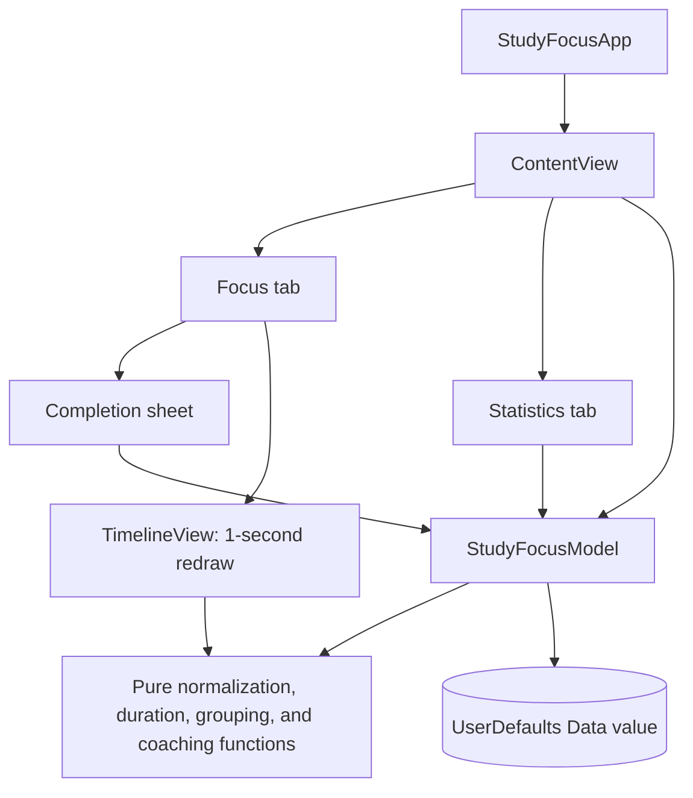
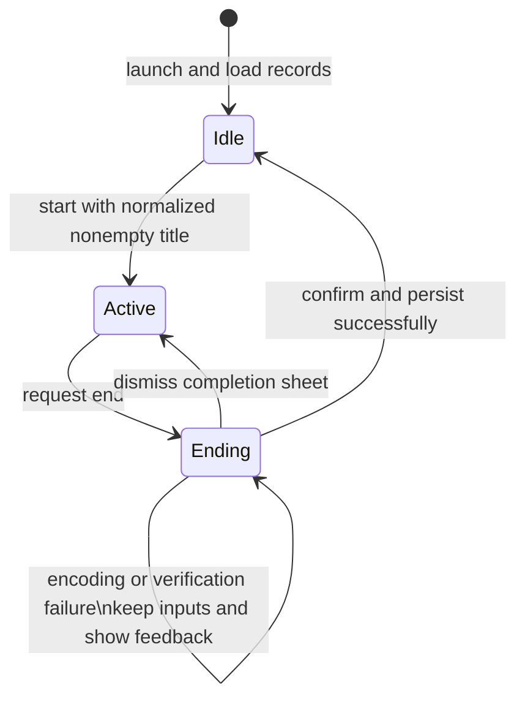

# Design Document: Study Focus Hackathon MVP

## Overview

Study Focus is a small iPhone SwiftUI demo for a 90-minute hackathon build. The implementation extends the current default two-file project (`StudyFocusApp.swift` and `ContentView.swift`) with one app-state/domain file rather than introducing repositories, services, coordinators, or a multi-module structure.

The app has two top-level destinations in a `TabView`:

- **Focus**: enter a title, start one in-memory session, view elapsed time and the 10-second Pomodoro demonstration, then end the session through a completion sheet with optional subject and memo.
- **Statistics**: view total completed focus time, totals by subject including `Uncategorized`, a daily bar chart, and exactly one coaching sentence based on records completed today.

All duration displays and saved durations derive from timestamps. A one-second SwiftUI timeline refreshes the active display but never increments or mutates stored elapsed time. Completed records are encoded as one `Data` value in `UserDefaults`.

### Scope boundaries

This design follows the exclusions in `requirements.md`. It does not add:

- app-leave count recording or app-leave time recording;
- SwiftData or a repository layer;
- local notifications or background audio;
- goals or streaks;
- JSON export;
- automated tests as part of the hackathon MVP implementation; or
- pending-result or active-session recovery after process termination.

An active session exists only in memory. Leaving the app does not create records or affect duration calculations; returning simply causes the display to derive the current elapsed duration from the unchanged start timestamp. The app does not observe scene phase for analytics.

### Research findings that inform the design

- SwiftUI `TimelineView` redraws time-dependent content according to a schedule, so a periodic one-second timeline can refresh timer text without treating timer callbacks as the source of truth ([Apple TimelineView documentation](https://developer.apple.com/documentation/swiftui/timelineview)).
- Apple documents `UserDefaults` as persistent storage for property-list-compatible values, including `Data`. The MVP therefore stores a single encoded record array under one stable key rather than creating a persistence layer ([Apple User Defaults overview](https://developer.apple.com/library/content/documentation/Cocoa/Conceptual/UserDefaults/AboutPreferenceDomains/AboutPreferenceDomains.html)).
- Swift Charts composes data visualizations from marks. A `Chart` containing one `BarMark` per grouped calendar day is enough for the required daily chart ([Apple Swift Charts introduction](https://developer.apple.com/videos/play/wwdc2022/10136/), [BarMark documentation](https://developer.apple.com/documentation/charts/barmark)).
- Foundation calendars convert absolute dates into calendar days. Grouping with `Calendar.current.startOfDay(for:)` and comparing with the same current calendar keeps daily statistics aligned with the device calendar ([Apple calendar documentation](https://developer.apple.com/library/content/documentation/Cocoa/Conceptual/DatesAndTimes/Articles/dtCalendars.html)).

These choices minimize code and dependencies while matching the timestamp, persistence, and device-calendar semantics in the requirements.

## Architecture

### Structure



The design uses a lightweight Model-View split:

- `StudyFocusApp` owns one `@StateObject` `StudyFocusModel` and injects it into `ContentView`.
- `ContentView` and small private subviews render state and forward user actions.
- `StudyFocusModel` is a `@MainActor ObservableObject` that owns active-session state, completion draft state, saved records, persistence actions, and pure derived calculations.
- `UserDefaults` is used directly by `StudyFocusModel`; there is deliberately no repository protocol or persistence abstraction.

A single added source file, `StudyFocusModel.swift`, can contain the two data structs, the observable model, and small derived-value structs. `ContentView.swift` can contain the root view and private `FocusView`, `CompletionView`, and `StatisticsView` declarations. This keeps the starter recognizable and avoids project-file changes because the Xcode project uses a file-system-synchronized source group.

### State flow



Only one `ActiveSession` optional is stored. The model guards `startSession` so repeated start actions cannot create a second active session. The start UI is replaced by the active-session UI while that value is present.

When completion is confirmed, the model captures one `confirmationTime` and uses it both as the record's `endDate` and as the endpoint for final duration. It stages the candidate record array, persists and verifies it, then commits UI state. On failure, it leaves the active session and completion draft unchanged and exposes an error message in the sheet.

## Components and Interfaces

### `StudyFocusApp`

Responsibilities:

- Create `StudyFocusModel(defaults: .standard)` once with `@StateObject`.
- Inject it into `ContentView`.
- Perform no scene-phase tracking, app-leave measurement, or persistence coordination.

### `ContentView`

Responsibilities:

- Present a `TabView` containing Focus and Statistics destinations.
- Observe the shared model.
- Present the completion sheet when `isCompletionPresented` is true.
- Keep visual composition in private subviews rather than adding navigation infrastructure.

### `FocusView`

Idle state:

- Bind a `TextField` to `sessionTitleDraft`.
- Disable the Start button when `normalize(sessionTitleDraft)` is empty.
- Call `startSession(now: Date())` once when Start is selected.

Active state:

- Display the active session's normalized title.
- Use `TimelineView(.periodic(from: active.startDate, by: 1))` to obtain a redraw date at least once per second while visible.
- Display `elapsedSeconds(from: active.startDate, to: context.date)`.
- Display Pomodoro text from the same start timestamp: `10`, then `9` through `1`, and `Complete` once elapsed time is at least 10 seconds.
- Call `requestSessionEnd()` to present completion details. Requesting end does not freeze or replace the original start timestamp.

Timer calculations use elapsed whole seconds:

```text
elapsedSeconds(start, now) = max(0, floor(now.timeIntervalSince(start)))

if elapsedSeconds < 10:
    pomodoro = remaining(10 - elapsedSeconds)  // values 10...1
else:
    pomodoro = complete
```

The timeline is only a redraw trigger. Correctness does not depend on every scheduled redraw occurring, which lets the displayed time catch up from timestamps after suspension.

### `CompletionView`

Responsibilities:

- Present optional Subject and Memo fields backed by model-owned drafts.
- Show save-failure feedback in the sheet when `completionErrorMessage` is non-`nil`.
- Call `confirmCompletion(now: Date())` when Save is selected.
- Leave both drafts intact if persistence fails.

`confirmCompletion` performs these steps in order:

1. Require an active session.
2. Capture one confirmation timestamp.
3. Normalize Subject and Memo by trimming leading and trailing whitespace/newlines and converting an empty result to `nil`.
4. Calculate final duration from the active start timestamp and captured confirmation timestamp.
5. Construct one `FocusRecord`.
6. Encode and save the candidate array, then read and decode it to verify that the candidate can be recovered.
7. On success, assign the candidate to `records`, clear the active session and drafts, clear any error, and dismiss the sheet.
8. On encoding, write-verification, or decode failure, keep active session and drafts unchanged and show an explicit save-failure message.

Because `UserDefaults.set` does not return a success result, immediate encoded-data read-back and decode provides an MVP-level verifiable failure boundary. If verification fails, the model restores the previously stored `Data` value when possible. This is intentionally local logic, not a repository.

### `StatisticsView`

Responsibilities:

- If `records` is empty, show text stating that no completed focus sessions have been recorded.
- Otherwise show:
  - total duration from all records;
  - subject totals, with absent subjects grouped under `Uncategorized`;
  - a Swift Charts bar chart with one sorted `DailyTotal` per represented device calendar day.
- Always show one, and only one, coaching `Text` generated by `coachingMessage(records:now:calendar:)`.

The statistics view does not cache aggregates. It derives them from the in-memory records array, preventing duplicate inclusion caused by incremental counters.

### `StudyFocusModel` interface

```swift
@MainActor
final class StudyFocusModel: ObservableObject {
    @Published var sessionTitleDraft: String
    @Published private(set) var activeSession: ActiveSession?
    @Published var completionSubjectDraft: String
    @Published var completionMemoDraft: String
    @Published private(set) var isCompletionPresented: Bool
    @Published private(set) var completionErrorMessage: String?
    @Published private(set) var records: [FocusRecord]

    init(defaults: UserDefaults = .standard)

    var canStartSession: Bool { get }
    func startSession(now: Date = Date())
    func requestSessionEnd()
    func dismissCompletion()
    func confirmCompletion(now: Date = Date())

    static func normalizeTitle(_ value: String) -> String
    static func normalizeOptional(_ value: String) -> String?
    static func elapsedSeconds(from start: Date, to end: Date) -> Int
    static func pomodoroState(from start: Date, to now: Date) -> PomodoroState
    static func totalDuration(in records: [FocusRecord]) -> Int
    static func subjectTotals(in records: [FocusRecord]) -> [SubjectTotal]
    static func dailyTotals(in records: [FocusRecord], calendar: Calendar) -> [DailyTotal]
    static func coachingMessage(
        records: [FocusRecord],
        now: Date,
        calendar: Calendar
    ) -> String
}
```

Default arguments keep view calls short. Explicit date and calendar inputs keep time-sensitive logic deterministic and prevent helper functions from sampling different timestamps during one operation.

### Persistence contract

- Key: `studyFocus.completedRecords.v1`
- Stored value: JSON-encoded `[FocusRecord]` as `Data`
- Load: missing data means an empty record array; malformed or undecodable data also produces an empty in-memory array.
- Save: encode the complete candidate record array and replace the key once; verify by reading and decoding the value before changing completion UI state.
- Failure display: a concise message such as `“Couldn’t save this focus session. Your subject and memo are still here.”`

The JSON payload is only an internal encoding for the required `UserDefaults` value. The excluded JSON export feature is not added.

## Data Models

### `ActiveSession`

```swift
struct ActiveSession: Equatable {
    let title: String       // normalized, nonempty
    let startDate: Date     // processing timestamp captured once
}
```

`ActiveSession` is not persisted. It represents the one allowed active focus session and remains unchanged until successful completion or an explicitly supported sheet dismissal back to the active screen.

### `FocusRecord`

```swift
struct FocusRecord: Identifiable, Codable, Equatable {
    let id: UUID
    let title: String
    let startDate: Date
    let endDate: Date
    let durationSeconds: Int
    let subject: String?
    let memo: String?
}
```

Invariants:

- `title` is normalized and nonempty.
- `durationSeconds == max(0, floor(endDate.timeIntervalSince(startDate)))`.
- `durationSeconds >= 0`.
- `subject` and `memo` are trimmed nonempty strings or `nil`.
- A successfully confirmed session contributes exactly one record because UI state is cleared only after one verified candidate-array save.

### Derived view data

```swift
enum PomodoroState: Equatable {
    case remaining(Int) // 10...1 only
    case complete
}

struct SubjectTotal: Identifiable, Equatable {
    let subject: String // normalized subject or "Uncategorized"
    let seconds: Int
    var id: String { subject }
}

struct DailyTotal: Identifiable, Equatable {
    let day: Date       // Calendar.startOfDay(for: endDate)
    let seconds: Int
    var id: Date { day }
}
```

Aggregation rules:

- Overall total is `records.reduce(0) { $0 + $1.durationSeconds }`.
- Subject totals group every record exactly once by `record.subject ?? "Uncategorized"` and sort labels for stable display.
- Daily totals group every record exactly once by `calendar.startOfDay(for: record.endDate)` and sort ascending by day.
- Today's set uses the same supplied device calendar and its day interval containing `now`, with an inclusive start and exclusive end.
- Empty-day coaching text is exactly one sentence: `Start a focus session today and give one task your full attention.`
- Nonempty-day coaching text is exactly one sentence: `You focused for {formatted total duration} today; keep building on that progress.`

Duration formatting is presentation-only. Calculations and persistence remain integer seconds.


## Correctness Properties

*A property is a characteristic or behavior that should hold true across all valid executions of a system-essentially, a formal statement about what the system should do. Properties serve as the bridge between human-readable specifications and machine-verifiable correctness guarantees.*

The prework properties were consolidated where one implementation rule subsumes several criteria. In particular, one elapsed-time property covers both live and final duration, one Pomodoro property covers start/countdown/completion, one subject-partition property covers named and uncategorized totals, and one coaching property covers selection, today's total, and sentence count. This avoids duplicate tests that exercise the same pure function.

### Property 1: Valid start creates one immutable active session

For any idle model, nonempty title after trimming, and processing timestamp, starting a session creates exactly one active session whose title is the normalized input and whose start timestamp equals the supplied processing timestamp; any additional start request while that session is active leaves the same active session unchanged.

**Validates: Requirements 1.1**

### Property 2: Whitespace-only titles cannot start

For all title strings containing no non-whitespace characters, title normalization produces an empty string and the session-start control state is unavailable.

**Validates: Requirements 1.2**

### Property 3: Timestamp duration is floored and nonnegative

For all start and endpoint timestamps, elapsed duration equals the whole number of seconds obtained by rounding down the endpoint-minus-start interval and clamping the result to zero, whether the endpoint represents a live display time or a completion confirmation time.

**Validates: Requirements 2.1, 2.2**

### Property 4: Pomodoro state derives from the session start

For all active-session start timestamps and current timestamps, the Pomodoro state derived from their elapsed interval is `remaining(10 - floor(elapsed))` with a value from 10 through 1 when clamped elapsed time is less than 10 seconds, and is `complete` when elapsed time is at least 10 seconds.

**Validates: Requirements 3.1, 3.2, 3.3**

### Property 5: Completion record preserves and normalizes session data

For any active session, confirmation timestamp, Subject input, and Memo input, a created record preserves the active title and start timestamp, uses the confirmation timestamp as its end timestamp, stores the timestamp-derived final duration, and stores each trimmed completion value as a nonempty optional or `nil` when the input contains no non-whitespace characters.

**Validates: Requirements 4.2**

### Property 6: Overall total counts every record once

For all saved record collections, the displayed overall focus duration equals the sum of every record's duration with no record omitted or included more than once.

**Validates: Requirements 5.1**

### Property 7: Subject totals form a complete partition

For all saved record collections, subject aggregation places every record into exactly one group keyed by its non-absent Subject or by `Uncategorized`, and each group total equals the sum of durations for exactly the records assigned to that key.

**Validates: Requirements 5.2, 5.3**

### Property 8: Daily totals form a complete calendar-day partition

For all saved record collections and device calendars, daily aggregation returns exactly one value for each represented `startOfDay(for: endDate)` key, each value equals the sum of durations of exactly the records ending on that calendar day, and the resulting values are ordered by day.

**Validates: Requirements 5.4**

### Property 9: Coaching selects one sentence from today's records

For all saved record collections, current timestamps, and device calendars, coaching derives exactly one nonempty sentence from records whose end timestamps fall in the current calendar-day interval: it returns the invitation sentence when that set is empty, and otherwise returns the single-sentence completed-focus template containing the sum of exactly those records' durations.

**Validates: Requirements 6.1, 6.2, 6.3, 6.4**

## Error Handling

| Condition | Detection | User-visible behavior | State behavior |
|---|---|---|---|
| Start title is empty or whitespace-only | `normalizeTitle` returns empty | Start button is disabled | No active session is created |
| A start action is received while active | `activeSession != nil` guard | Existing active UI remains | Existing title and start timestamp remain unchanged |
| Current or end timestamp precedes start | Duration helper sees a negative interval | Display/save `0` seconds | No negative duration enters state |
| Completion is requested without an active session | Model guard | No sheet transition | No record or draft mutation |
| Record encoding fails | `JSONEncoder.encode` throws | Sheet shows save-failure feedback | Active session, Subject, and Memo remain intact |
| UserDefaults read-back is missing, differs, or cannot decode after save | Immediate verification fails | Sheet shows save-failure feedback | Candidate records are not committed; drafts remain; previous stored data is restored when available |
| No stored data exists on launch | `data(forKey:) == nil` | Empty-statistics state and no-activity coaching sentence | `records = []` |
| Stored data is malformed or incompatible | `JSONDecoder.decode` throws | Statistics use the required empty state | `records = []`; the app remains usable |
| Statistics contain no records | `records.isEmpty` | State explicitly says no completed focus sessions have been recorded | Chart and aggregate rows do not invent zero-value days or subjects |

Save errors are handled where the user can act on them, inside the completion sheet. Load/decode errors fall back to an empty collection as required. The MVP does not add migration, cloud backup, retry queues, or pending-result recovery.

## Testing Strategy

Automated tests are explicitly outside the 90-minute MVP implementation scope, so this design does not require adding a test target, package dependency, or test files during the hackathon. The pure helper boundaries still make later verification direct, and the demo should receive focused manual checks before presentation.

### Manual hackathon verification

Use an iPhone simulator or device to verify the complete path:

1. Confirm Start is disabled for empty and whitespace-only titles.
2. Start a title with surrounding whitespace and confirm the trimmed title appears.
3. Confirm elapsed time advances at least once per second and the Pomodoro display runs from 10 through 1 before showing complete at 10 seconds.
4. Background and foreground the app during an active session; confirm elapsed time catches up from the original timestamp and no app-leave count or time is recorded.
5. End the session, enter optional Subject and Memo values, save, relaunch, and confirm the record contributes once to statistics.
6. Save sessions with the same subject, different subjects, and no subject; confirm overall and subject totals, including `Uncategorized`.
7. Use records ending on multiple device calendar days to confirm one chart bar per represented day.
8. Confirm statistics with no records show the explicit empty state and one invitation sentence.
9. Confirm today's records produce one coaching sentence containing today's total only.
10. Seed malformed `Data` for the defaults key during development and confirm launch falls back to empty statistics without crashing.

### Deferred unit and integration tests

If automated tests are added after the MVP, example-based XCTest or Swift Testing cases should cover:

- active-title rendering;
- completion-sheet presentation with Subject and Memo fields;
- preservation of completion drafts and visible feedback under a forced save-verification failure;
- isolated-`UserDefaults` save/load round trips;
- malformed stored data fallback;
- empty-statistics rendering;
- one-second timeline wiring and start-timestamp preservation; and
- exact coaching templates, including a UI assertion that only one coaching `Text` is rendered.

Each persistence test should use a uniquely named `UserDefaults` suite and remove that suite's domain during teardown so tests cannot affect app or one another.

### Deferred property-based tests

Property-based testing is appropriate for the app's pure normalization, timestamp arithmetic, Pomodoro mapping, record construction, aggregation, and coaching functions. If the exclusion on automated tests is lifted, use the [SwiftCheck](https://github.com/typelift/SwiftCheck) package rather than implementing generators manually.

- Run each property with at least 100 generated cases.
- Implement each numbered correctness property as one property-based test.
- Generate fractional and negative timestamp intervals, Unicode whitespace, optional completion strings, repeated subjects, nil subjects, zero durations, and dates around device-calendar day boundaries.
- Keep `UserDefaults`, SwiftUI rendering, and timer scheduling out of property loops; cover those with the example and integration tests above.
- Place a traceability comment on every property test using this exact form: `Feature: study-focus-hackathon-mvp, Property {number}: {property text}`.

Unit examples and property tests are complementary: examples cover concrete UI and failure paths, while generated properties cover the broad input spaces of the pure domain calculations. No test implementation is part of the present hackathon scope.